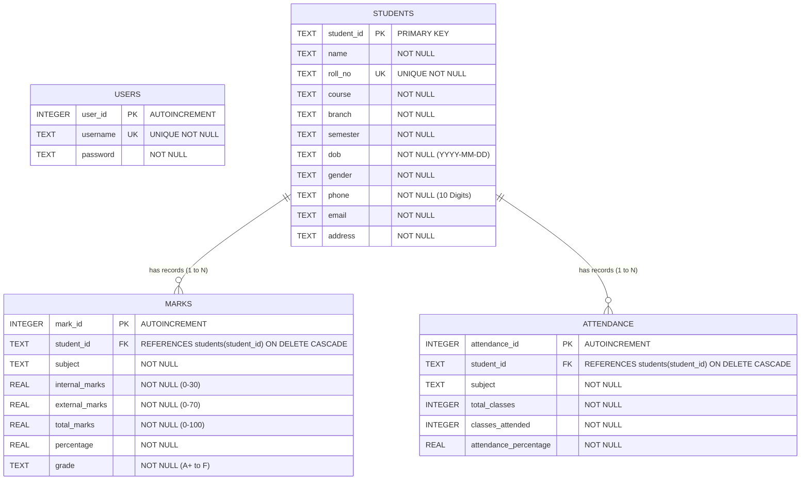

# 🎓 Academic Documentation & Viva Voce Guide
## Project: Student Management System (Python + Tkinter + SQLite3)
**Target Level**: 3rd-Year B.Tech Computer Science & Engineering (PBL / Capstone Submission)

---

## 1. Project Abstract

The **Student Management System (SMS)** is an administrative desktop software suite designed to modernize, centralize, and automate academic record-keeping in higher educational institutions. Traditionally, academic institutions rely on paper registers or fragmented spreadsheets to track student personal dossiers, internal assessments, semester exam marks, and daily attendance. This manual approach is highly prone to human error, record degradation, unauthorized data tampering, and severe reporting delays.

The proposed software is built entirely using **Python 3**, **Tkinter & ttk** for an event-driven graphical interface, and an embedded **SQLite3** relational database engine. The system provides an end-to-end administrative portal featuring role-based authentication, student demographic tracking (full CRUD), automated grading algorithms based on university evaluation criteria, attendance compliance monitoring with shortage warnings (< 75%), 360-degree consolidated student profiles, and multi-format institutional report generation (CSV & Formatted Text). Built without external third-party dependencies, the system delivers high computational efficiency, absolute portability, zero-configuration deployment, and strict ACID compliance through relational integrity constraints and parameterized SQL queries.

---

## 2. Problem Statement

Manual management of academic institutions involves substantial paperwork, repetitive clerical effort, and logistical vulnerabilities. Specific challenges in legacy systems include:

1. **High Risk of Data Inconsistency & Loss**: Physical registers deteriorate over time, and disparate spreadsheets result in duplicated, conflicting student records.
2. **Computational Inefficiencies**: Faculty members must manually tally internal and external marks, compute overall percentages, and assign letter grades across hundreds of students, leading to calculation errors.
3. **Late Identification of Attendance Defaulters**: Tracking whether a student meets the statutory 75% attendance threshold requires manual audits at the end of the semester, preventing timely intervention.
4. **Security & Access Control Vulnerabilities**: Paper files and unencrypted local spreadsheets can be easily viewed or modified without an audit trail.
5. **Cumbersome Report Generation**: Compiling merit lists, student rosters, and debarred lists for university accreditation or examination branches requires hours of manual aggregation.

---

## 3. Project Objectives

- **Develop a Centralized Database**: Implement an SQLite3 relational schema that stores student personal details, academic marks, and attendance records with enforced referential integrity.
- **Provide a User-Friendly Graphical Interface**: Create an intuitive, modern desktop interface using Python's Tkinter framework that eliminates the need for manual command-line interaction.
- **Automate Academic Calculations**: Automatically calculate total marks, percentage scores, letter grades (`A+` through `F`), and attendance compliance statuses in real time.
- **Implement Strict Client-Side & Database Validation**: Prevent garbage data entry via regular expressions for emails, 10-digit phone number validation, calendar date parsing, and duplicate primary key/roll number prevention.
- **Facilitate Administrative Analytics & Reporting**: Enable 1-click generation and export of official institutional reports (Merit Lists, Defaulter Reports, Complete Directory) into CSV and Text formats.
- **Ensure Portability & Maintainability**: Organize the codebase into a modular Model-View-Controller (MVC) structure relying exclusively on the Python standard library.

---

## 4. Proposed System

The proposed desktop system resolves the drawbacks of manual record keeping through a modular architecture:

```
+-------------------------------------------------------------+
|                     Presentation Layer                      |
| (Tkinter GUI: LoginWindow, DashboardWindow, Management Frames) |
+-------------------------------------------------------------+
                              |
                              v
+-------------------------------------------------------------+
|                     Business Logic Layer                    |
|   (utils.py: Validation, Grading Formulas, Attendance Engine)|
+-------------------------------------------------------------+
                              |
                              v
+-------------------------------------------------------------+
|                      Data Access Layer                      |
|  (database.py: SQLite3, Parameterized Queries, Cascade DDL) |
+-------------------------------------------------------------+
```

### Key Highlights of the Proposed System:
- **Instant Synchronization**: Every change in marks or attendance dynamically updates the dashboard KPI cards and student profiles.
- **Integrity Enforcement**: Deleting a student automatically purges their corresponding marks and attendance records via `ON DELETE CASCADE`.
- **Zero-Dependency Deployment**: Standard Python libraries eliminate package conflicts or external server requirements.

---

## 5. Technologies Used

### 1. Python 3
- Serves as the primary programming language.
- Offers clear, readable syntax, strong typing, and rich built-in modules (`sqlite3`, `csv`, `re`, `datetime`).

### 2. Tkinter & ttk
- The standard Python GUI toolkit wrapping the Tcl/Tk graphic libraries.
- Employs advanced `ttk` (themed widgets) such as `Treeview` (tabular multi-column grids), `Combobox` (dropdown selectors), and styled buttons for a professional look.

### 3. SQLite3
- A self-contained, serverless, zero-configuration, transactional SQL database engine.
- Stores the entire institutional database inside a single binary file (`student_management.db`), making backups and portability seamless.

### 4. Structured Query Language (SQL)
- Employs ANSI SQL syntax for Data Definition Language (DDL) and Data Manipulation Language (DML).
- Uses parameterized queries (`?` placeholders) to prevent SQL Injection attacks.

---

## 6. DBMS Concepts Used

| DBMS Concept | Implementation in this Project |
| :--- | :--- |
| **Relational Database** | Managed via SQLite3, storing entities in relational tables. |
| **Tables / Relations** | Four core relations: `users`, `students`, `marks`, and `attendance`. |
| **Primary Key (PK)** | `student_id` in `students`, `user_id` in `users`, `mark_id` in `marks`, `attendance_id` in `attendance`. Ensures unique entity identification. |
| **Foreign Key (FK)** | `student_id` in `marks` and `attendance` references `students(student_id)`. |
| **Referential Integrity** | `ON DELETE CASCADE` ensures that deleting a student purges orphaned marks and attendance logs. Enforced via `PRAGMA foreign_keys = ON;`. |
| **Uniqueness Constraint** | `roll_no` in `students` and `username` in `users` have `UNIQUE` constraints to avoid duplicate admissions. |
| **CRUD Operations** | Complete **C**reate (`INSERT`), **R**ead (`SELECT`), **U**pdate (`UPDATE`), and **D**elete (`DELETE`) across all entities. |
| **Joins & Aggregations** | `LEFT JOIN` and `INNER JOIN` operations combine student names with marks and attendance. `AVG()`, `SUM()`, and `COUNT()` compute merit lists and institutional averages. |
| **Parameterized Queries** | Uses `cursor.execute(sql, (param1, param2))` to separate SQL command logic from user data, eliminating SQL Injection vulnerabilities. |

---

## 7. Python Concepts Used

| Python Concept | Where & How Used |
| :--- | :--- |
| **Object-Oriented Programming (OOP)** | Every GUI module is encapsulated as a class (`StudentManagementFrame`, `DashboardWindow`, `LoginWindow`) inheriting from `tk.Frame` or managing a `tk.Tk`/`tk.Toplevel` window. |
| **Modular Programming** | Code is separated into 10 modular files, each with a single responsibility (SoC principle). |
| **Exception Handling (`try-except-finally`)** | Traps `sqlite3.Error`, `sqlite3.IntegrityError`, `ValueError`, and I/O errors gracefully, showing user-friendly messageboxes instead of crashing. |
| **Regular Expressions (`re` module)** | Employs `re.match` and `re.fullmatch` for RFC-compliant email verification and strict 10-digit phone validation. |
| **File I/O & CSV Processing** | Built-in `csv.writer` and context managers (`with open(...) as f`) export reports into `.csv` and aligned `.txt` files. |
| **Event-Driven Architecture** | Binds widget events such as `<<TreeviewSelect>>` (row selection), `<Return>` (Enter key submit), and `<KeyRelease>` (live formula calculation) to event handlers. |
| **Unit Testing (`unittest` module)** | Automated test suite in `test_system.py` executes 7 automated test cases verifying schema, CRUD, cascade deletes, and validation logic. |

---

## 8. Entity-Relationship (ER) Diagram



### ER Diagram Explanation:
1. **Users Entity**: Represents administrative credentials (`user_id`, `username`, `password`). Completely decoupled from student entities for security.
2. **Students Entity (Parent/Master Entity)**: Represents the core student record. `student_id` is the Primary Key. `roll_no` has a Unique constraint.
3. **Marks Entity (Child/Dependent Entity)**: Represents subject-wise performance. Linked to `students` via Foreign Key `student_id`. A single student can have multiple marks records (1-to-Many relationship).
4. **Attendance Entity (Child/Dependent Entity)**: Represents classroom lecture attendance. Linked to `students` via Foreign Key `student_id`. A single student can have multiple attendance records across subjects (1-to-Many relationship).
5. **Referential Integrity**: When a student is deleted from `students`, SQLite's `ON DELETE CASCADE` rule automatically removes corresponding records in `marks` and `attendance`, preventing orphaned rows.

---

## 9. Comprehensive Viva Voce Questions & Answers (25 Questions)

### Q1. What is the architecture of your Student Management System?
**Answer**: The system follows a modular Model-View-Controller (MVC) architecture.
- **Model**: SQLite database (`database.py`) and business logic formulas (`utils.py`).
- **View**: Tkinter GUI presentation screens (`dashboard.py`, `student.py`, `marks.py`, `attendance.py`, `profile_view.py`, `reports.py`).
- **Controller**: Event listener callbacks, input validation handlers, and SQL execution pipelines bridging the GUI and database.

---

### Q2. Why did you choose SQLite3 instead of MySQL or PostgreSQL?
**Answer**: SQLite3 is an embedded, serverless, self-contained relational database that requires zero configuration. It stores the entire database in a single local disk file (`student_management.db`). For an academic desktop application, this guarantees 100% portability, eliminates the overhead of managing a background database server daemon, and guarantees ACID compliance with low resource utilization.

---

### Q3. How did you implement and enable Foreign Key constraints in SQLite3?
**Answer**: By default, SQLite disables foreign key constraint enforcement for backwards compatibility. In our application:
1. In the DDL statements, we defined `FOREIGN KEY (student_id) REFERENCES students(student_id) ON DELETE CASCADE`.
2. On every database connection opened via `get_connection()`, we explicitly execute:
   ```python
   conn.execute("PRAGMA foreign_keys = ON;")
   ```
   This activates active constraint checks and cascading operations.

---

### Q4. What happens when a student record is deleted?
**Answer**: Because we configured foreign keys with `ON DELETE CASCADE`, deleting a row in the `students` table automatically triggers SQLite to delete all child rows associated with that `student_id` in the `marks` and `attendance` tables, ensuring database consistency without orphan records.

---

### Q5. How does your system protect against SQL Injection attacks?
**Answer**: We use **parameterized queries** throughout the entire application. Instead of formatting strings (`f"SELECT * FROM users WHERE user='{u}'"`), we pass parameter tuples to SQLite:
```python
cursor.execute("SELECT * FROM users WHERE username = ? AND password = ?", (username, password))
```
The SQLite engine treats input parameters strictly as literal data rather than executable SQL code, preventing SQL injection vulnerabilities.

---

### Q6. What is the role of Tkinter `Treeview` and why is it used?
**Answer**: `ttk.Treeview` is a specialized widget used to display hierarchical data and multi-column tabular records. In our project, it serves as the primary data grid for displaying enrolled students, marks, attendance logs, and generated reports. It supports column headers, row selection bindings (`<<TreeviewSelect>>`), and is coupled with vertical and horizontal scrollbars.

---

### Q7. How does row selection in the Treeview populate the input form?
**Answer**: We bind the virtual event `<<TreeviewSelect>>` on the Treeview widget to an event handler method (`on_row_select`). When a user clicks a row, the method queries `self.tree.focus()`, extracts the row values via `self.tree.item(selected_item, "values")`, and populates the corresponding `StringVar` instances attached to the input widgets.

---

### Q8. Explain the validation techniques applied in the Student Management module.
**Answer**: Multiple client-side validations are executed before interacting with the database:
1. **Required Fields**: Verifies that no mandatory field is left empty or whitespace-only.
2. **Email Validation**: Uses regular expression `^[a-zA-Z0-9_.+-]+@[a-zA-Z0-9-]+\.[a-zA-Z0-9-.]+$`.
3. **Phone Number**: Uses `re.fullmatch(r"\d{10}", cleaned)` to ensure exactly 10 numeric digits.
4. **Date of Birth**: Parsed using `datetime.strptime(date, "%Y-%m-%d")` to ensure valid calendar dates that are not in the future.
5. **Uniqueness**: Queries the database to prevent duplicate `student_id` and `roll_no` entries.

---

### Q9. What grading scale is implemented in the Marks Management module?
**Answer**: We implemented a 7-tier university grading rubric based on total marks (Internal out of 30 + External out of 70 = Total 100):
- **90% - 100%**: Grade `A+`
- **80% - 89%**: Grade `A`
- **70% - 79%**: Grade `B+`
- **60% - 69%**: Grade `B`
- **50% - 59%**: Grade `C`
- **40% - 49%**: Grade `D`
- **Below 40%**: Grade `F` (Fail)

---

### Q10. How is attendance compliance determined in the Attendance module?
**Answer**: Attendance percentage is computed dynamically as:
$$\text{Attendance Percentage} = \left(\frac{\text{Classes Attended}}{\text{Total Classes Conducted}}\right) \times 100$$
The status is classified into three categories:
- **Good**: $\ge 75\%$ (Eligible for university semester examinations).
- **Average**: $60\% - 74\%$ (Attendance warning issued).
- **Low**: $< 60\%$ (Critical shortage / risk of being debarred).

---

### Q11. How is real-time dynamic calculation implemented in the GUI?
**Answer**: We bind the `<KeyRelease>` keyboard event to the entry fields for marks (`Internal` and `External`) and attendance (`Total Classes` and `Classes Attended`). As the administrator types numbers into the entry widgets, the callback function triggers, validates the numeric inputs, computes the formulas, and updates the display labels in real time.

---

### Q12. Explain the purpose of `main.py` and `database.py`.
**Answer**:
- `database.py`: Encapsulates database connection creation, table schema DDL execution, foreign key enablement, and default admin/sample data seeding.
- `main.py`: Serves as the application bootstrapper. It configures Windows high-DPI scaling, applies modern `ttk` theme styles, calls `init_db()`, and initializes the `LoginWindow` event loop.

---

### Q13. How does the application handle password security on the login screen?
**Answer**: The password entry widget uses the attribute `show="*"`, which replaces characters with asterisks as the user types to prevent shoulder surfing. We also provide a "Show Password" checkbox that dynamically toggles the `show` attribute between `""` (plain text) and `"*"` (masked).

---

### Q14. What happens when an invalid username or password is entered?
**Answer**: The system queries `SELECT user_id, username FROM users WHERE username = ? AND password = ?`. If no row is returned, `messagebox.showerror` alerts the user with an "Access Denied" dialog, clears the password field, and refocuses the cursor back to the password input.

---

### Q15. How does the Dashboard switch between different screens without opening multiple windows?
**Answer**: The Dashboard uses a single-window dynamic container design. The main window is split into a fixed left sidebar and a central content `Frame`. When a user clicks a navigation item (e.g., "Students", "Marks", "Reports"), the `clear_content_area()` method destroys the active frame inside the container, instantiates the target module frame, and calls `.pack(fill=tk.BOTH, expand=True)`.

---

### Q16. How did you implement report export to CSV and Text format?
**Answer**:
- **CSV Export**: Uses Python's built-in `csv.writer` module. It prompts the user for a destination file using `filedialog.asksaveasfilename()`, writes institutional metadata headers, and iterates through rows to write comma-separated values.
- **TXT Export**: Uses standard file I/O (`open(path, 'w', encoding='utf-8')`). It dynamically measures the maximum string length of each column, formats equal column padding using `.ljust()`, and renders an aligned ASCII report.

---

### Q17. What is an IntegrityError in SQLite and how do you handle it?
**Answer**: An `sqlite3.IntegrityError` occurs when a database constraint is violated, such as attempting to insert a duplicate Primary Key (`student_id`), a duplicate `UNIQUE` column (`roll_no`), or violating a `NOT NULL` condition. We trap this using `try-except sqlite3.IntegrityError` and display a clear error message specifying which constraint was violated.

---

### Q18. What is the difference between `Tk` and `Toplevel` in Tkinter?
**Answer**:
- `tk.Tk()` is the main root window of a Tkinter application. There should typically only be one `Tk` instance running the main event loop (`mainloop()`).
- `tk.Toplevel()` creates a secondary top-level window that sits on top of the root window, sharing the same Tcl interpreter. In our system, the Dashboard window is created as a `Toplevel` or managed clean root when transitioning from login.

---

### Q19. How did you implement high-DPI awareness on Windows?
**Answer**: On high-resolution displays (4K/Retina/1080p scaling), Tkinter applications can appear blurry. In `main.py`, we call Windows system libraries using `ctypes`:
```python
from ctypes import windll
windll.shcore.SetProcessDpiAwareness(1)
```
This tells Windows to render Tkinter text and UI controls at native monitor DPI.

---

### Q20. What is the purpose of `StringVar` and `BooleanVar` in Tkinter?
**Answer**: `StringVar` and `BooleanVar` are Tkinter control variable classes that wrap Python data types. They support two-way data binding: when an `Entry` is linked to a `StringVar`, typing in the entry updates the variable, and calling `.set()` on the variable immediately updates the widget on screen.

---

### Q21. Explain the SQL query used to find top-performing students for the Merit List.
**Answer**:
```sql
SELECT s.student_id, s.name, s.roll_no, s.course, s.branch,
       AVG(m.total_marks) as avg_pct
FROM students s
INNER JOIN marks m ON s.student_id = m.student_id
GROUP BY s.student_id
HAVING COUNT(m.mark_id) > 0
ORDER BY avg_pct DESC;
```
This performs an `INNER JOIN` between `students` and `marks`, groups records by `student_id`, calculates the arithmetic average of `total_marks` across all subjects using `AVG()`, filters out students with no recorded marks using `HAVING`, and sorts them in descending order (`DESC`) to produce a ranked merit list.

---

### Q22. Explain the SQL query used to detect attendance shortage defaulters (< 75%).
**Answer**:
```sql
SELECT s.student_id, s.name, s.roll_no, s.course,
       SUM(a.total_classes) as tot_classes,
       SUM(a.classes_attended) as tot_attended
FROM students s
INNER JOIN attendance a ON s.student_id = a.student_id
GROUP BY s.student_id
HAVING SUM(a.total_classes) > 0 
   AND ((SUM(a.classes_attended) * 100.0) / SUM(a.total_classes)) < 75.0
ORDER BY ((SUM(a.classes_attended) * 100.0) / SUM(a.total_classes)) ASC;
```
This aggregates the total lectures held and attended across all enrolled subjects for each student using `SUM()`. The `HAVING` clause filters for students whose cumulative attendance ratio is strictly less than $75.0\%$, sorted ascending so the most severe defaulters appear first.

---

### Q23. Why did you avoid using global variables in your Python code?
**Answer**: Global variables create tight coupling, make code difficult to debug, and lead to race conditions. Instead, we used Object-Oriented Programming (OOP), encapsulating state within class attributes (`self.var_student_id`, `self.tree`, `self.current_user`), ensuring clean scope isolation and maintainability.

---

### Q24. How is data persistence verified after closing the application?
**Answer**: Whenever a transaction is performed (Add, Update, Delete), we invoke `conn.commit()`. This instructs SQLite to write the transaction to the WAL (Write-Ahead Log) or database file on physical storage. When the application closes and reopens, `init_db()` reconnects to `student_management.db`, and all records remain intact.

---

### Q25. What future enhancements would you propose if this project were deployed campus-wide?
**Answer**:
1. **Multi-Role Authentication**: Add separate portals for Students (view only), Faculty (enter marks/attendance), and Dean/Admin (full privileges).
2. **Automated Parent Alerts**: Integrate SMTP email or SMS gateways to automatically dispatch deficiency notices when attendance falls below 75%.
3. **Biometric Integration**: Connect fingerprint or RFID card readers to automatically log attendance into the SQLite `attendance` table.
4. **PDF Marksheets**: Implement ReportLab to generate official college grade sheets with digital signature verification.
