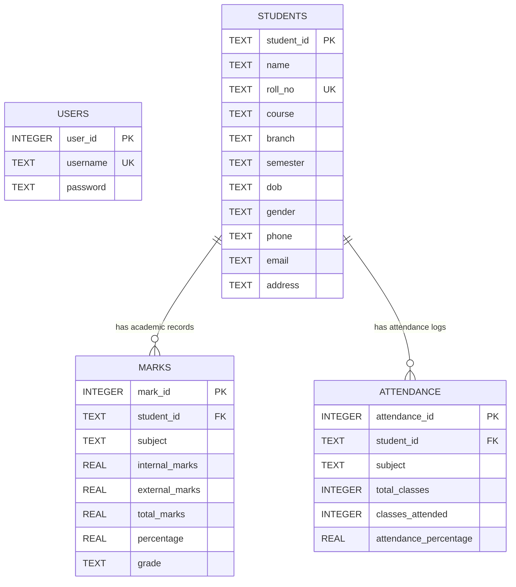

# 🎓 Student Management System (SMS)

> A modern, modular desktop application for managing college student enrollments, academic performance, and classroom attendance. Developed in pure **Python 3**, **Tkinter**, and **SQLite3** as a 3rd-Year B.Tech Computer Science Capstone / PBL Project.

---

## 📌 1. Project Overview

The **Student Management System (SMS)** is an administrative desktop software solution engineered to digitize and automate manual record-keeping in academic institutions. It provides a centralized graphical dashboard for university administrators, department heads, and faculty coordinators to perform student admissions, record internal and external marks, compute academic grades, monitor lecture attendance compliance, and export statutory institutional reports.

The project strictly follows a **modular architecture**, enforces relational database constraints (including Foreign Keys and `ON DELETE CASCADE` behaviors), and employs parameterized SQL statements to safeguard against SQL Injection vulnerabilities.

---

## 🚀 2. Key Features

- **🔐 Role-Based Admin Authentication**:
  - Masked password entry with toggleable show/hide functionality.
  - Parameterized database verification against the `users` table.
  - Default credentials: `admin` / `admin123`.

- **📊 Real-time Administrative Dashboard**:
  - Live Key Performance Indicator (KPI) metric cards: *Total Students*, *Active Courses*, *Distinct Subjects*, and *Institutional Average %*.
  - Live system clock and calendar display.
  - Quick-action shortcuts for rapid data entry.
  - Recent student enrollment feed.

- **👨‍🎓 Student Master Records (Full CRUD)**:
  - Fields: Student ID, Full Name, Roll No, Course, Branch, Semester, DOB, Gender, Phone, Email, Address.
  - Real-time client-side validation: 10-digit phone numbers, RFC-compliant email regex, and valid calendar dates.
  - Dual-scrollbar interactive Treeview table with 1-click row population for instant editing and deletion.
  - Dedicated search filtering by Student ID, Name, Roll No, Course, or Branch.

- **📝 Academic Marks & Automatic Grading**:
  - Captures Internal marks (max 30) and External university marks (max 70).
  - Real-time automatic calculation of Total Marks (100), Subject Percentage, and 7-tier Letter Grade (`A+` to `F`).
  - Cumulative GPA / percentage calculation across all enrolled subjects.

- **📅 Attendance Tracking & Shortage Alerts**:
  - Captures Total Classes Conducted and Classes Attended.
  - Real-time percentage calculation: $\text{Attendance \%} = \left(\frac{\text{Attended}}{\text{Total}}\right) \times 100$.
  - Three-tier automated compliance classification:
    - **Good** ($\ge 75\%$): University examination eligible.
    - **Average** ($60\% - 74\%$): Warning zone.
    - **Low** ($< 60\%$): Critical shortage / debarred alert.

- **👤 360-Degree Student Profile Dossier**:
  - Comprehensive single-window view combining personal bio, complete subject-wise marks card, and attendance compliance record.

- **📑 Institutional Reports & Data Export**:
  - Generates 5 pre-configured reports:
    1. Complete Student Directory
    2. Academic Performance Report
    3. Top-Performing Students (Merit Ranking)
    4. Student Attendance Summary Report
    5. Attendance Shortage Warning List ($< 75\%$)
  - 1-click export to **CSV format** (`.csv`) or **Formatted Text Document** (`.txt`) using Python's built-in file handling.

---

## 🛠️ 3. Technologies Used

| Technology | Role in System | Standard / Built-in |
| :--- | :--- | :--- |
| **Python 3.x** | Core Programming Language & Business Logic | Standard |
| **Tkinter & ttk** | Graphical User Interface (GUI) & Event-Driven Loop | Python Standard Library |
| **SQLite3** | Relational Database Management System (RDBMS) | Python Standard Library |
| **CSV & File I/O**| Report Generation & Data Exportation | Python Standard Library |
| **Regular Expressions (`re`)** | Email & Phone Input Validation | Python Standard Library |
| **Datetime** | Timestamping & Calendar Validations | Python Standard Library |

> **Zero External Dependencies**: The application requires **no `pip install`** packages, guaranteeing 100% portability across university lab computers and evaluation systems.

---

## 📂 4. Project Directory Structure

```text
Student_Management_System/
│
├── main.py                  # Application entry point, styling, and window lifecycle
├── database.py              # SQLite connection, schema DDL, and sample data seeder
├── utils.py                 # Validation regex, grading rules, theme configuration
├── login.py                 # Admin login window with password masking
├── dashboard.py             # Administrative shell, navigation sidebar & KPI cards
├── student.py               # Student CRUD management & Treeview table
├── marks.py                 # Academic evaluations, marks CRUD & auto-grading
├── attendance.py            # Attendance logging, calculations & shortage alerts
├── profile_view.py          # 360-degree student academic dossier
├── reports.py               # Institutional reports generator & CSV/TXT exporter
├── test_system.py           # Automated unit & integration test suite (unittest)
├── student_management.db    # SQLite relational database (auto-generated)
├── ACADEMIC_DOCS.md         # Abstract, problem statement, DBMS/Python concepts & Viva Q&A
└── README.md                # Project documentation & execution guide
```

---

## 🗄️ 5. Database Schema & Architecture

The database is built on SQLite3 with foreign keys explicitly enforced (`PRAGMA foreign_keys = ON;`).



### Cascade Deletion:
When a student record is removed from `students`, all associated rows in `marks` and `attendance` are automatically deleted via `ON DELETE CASCADE`.

---

## 💻 6. How to Run the Project (Windows Setup)

### Step 1: Verify Python 3 Installation
Open PowerShell or Command Prompt and ensure Python 3 is installed:
```powershell
python --version
```
*(Ensure Python 3.8+ is installed with the "Add Python to PATH" option checked during installation).*

### Step 2: Navigate to Project Folder
```powershell
cd "C:\Users\risha\Desktop\deepanshupython pbl"
```

### Step 3: Launch the Application
Run the entry point file:
```powershell
python main.py
```
> *Note: On initial launch, `student_management.db` will be automatically generated and pre-seeded with sample records.*

### Step 4: Login with Default Admin Credentials
- **Username**: `admin`
- **Password**: `admin123`

---

## 🧪 7. Running the Automated Test Suite

The project includes a built-in automated test suite covering database creation, foreign key cascade deletion, validation logic, and grading formulas:
```powershell
python test_system.py
```
Expected output:
```text
.......
----------------------------------------------------------------------
Ran 7 tests in 0.092s

OK
```

---

## 📸 8. Screenshots & User Interface Walkthrough

| Screen | Description |
| :--- | :--- |
| **Login Portal** | Clean card-based login with password masking and error alerts. |
| **Dashboard** | Modern slate-navy sidebar with 4 real-time KPI cards and quick actions. |
| **Student Management** | Two-column layout with validated data entry form and scrollable Treeview. |
| **Marks Management** | Internal/External marks entry with real-time grade computation. |
| **Attendance Tracker**| Lecture tracking with automatic percentage and color-coded status badges. |
| **Student Dossier** | Comprehensive profile combining bio, marks, and attendance. |
| **Reports & Export** | Filterable audit reports with 1-click export to CSV and formatted TXT. |

---

## 🔮 9. Future Enhancements

1. **Role-Based Access Control (RBAC)**: Distinct logins for Faculty (marks/attendance entry only) and Students (read-only grade cards).
2. **Automated Email Notifications**: Automatic SMTP emails to parents when a student's attendance falls below $75\%$.
3. **Biometric / RFID Integration**: Direct attendance synchronization with hardware card scanners.
4. **PDF Grade Card Generation**: Generating signed digital marksheets via ReportLab.
5. **Data Visualization**: Matplotlib-based semester-over-semester trend charts and CGPA distribution histograms.

---

## 👨‍💻 Project Developer
- **Degree**: B.Tech Computer Science & Engineering (3rd Year)
- **Course**: Python Programming Laboratory / Project Based Learning (PBL)
